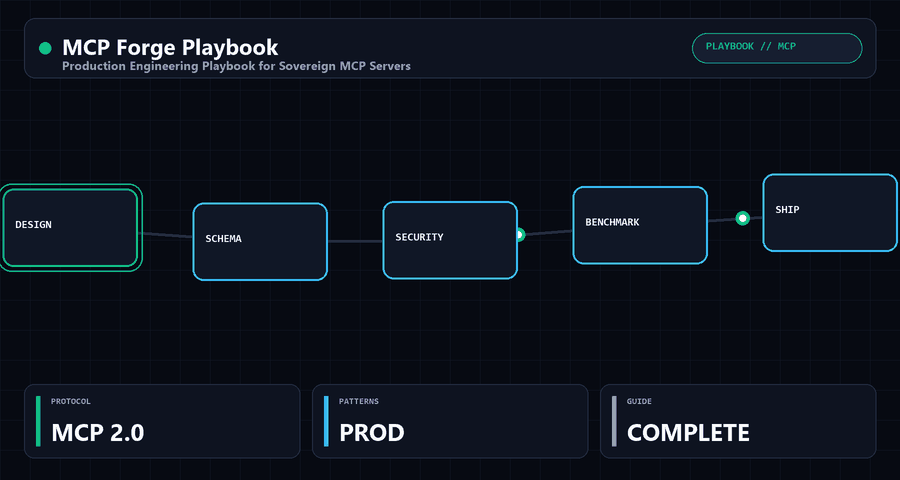

<div align="center">


<br/>

[](#)
[](#)
[](LICENSE)
[](https://benni-os.net)

<br/>

> **Production Engineering Playbook for Sovereign MCP Servers.**  
> Part of the **Benni Master OS** sovereign engineering ecosystem.

<br/>



</div>

---

**Private.** MCP Forge Operator Playbook — 5-Part Audio Guide delivery page.

This repo is private by design. The `product.html` + `audio/` folder are served
only to paying customers via a private GitHub Pages URL or custom delivery mechanism.

## Structure

```
/
├── product.html          # Audio guide player page
└── audio/
    ├── product-ep01-intro-vision.m4a
    ├── product-ep02-architecture.m4a
    ├── product-ep03-build-validation.m4a
    ├── product-ep04-testing-deploy.m4a
    └── product-ep05-contribs-stack.m4a
```

## Deploy

After cloning, add the 5 M4A files inside `audio/` and push.
Enable GitHub Pages (Settings > Pages > Branch: main) to generate the delivery URL.

## Benni-os

https://benni-os.net
---

## 🏛️ Commercial & Sovereign Architecture

Need autonomous multi-agent swarm orchestration, private datacenter infrastructure, or enterprise governance?

- **Official Website:** [https://benni-os.net](https://benni-os.net)
- **Operator Mode Playbook:** [https://benni-os.net/blog/academy.html](https://benni-os.net/blog/academy.html)
- **GitHub Organization:** [https://github.com/Benni-OS](https://github.com/Benni-OS)
- **Maintainer:** [Benni Alencar](https://github.com/BenniAlencar)

---

## 📄 License & Provenance

- **License:** [MIT License](LICENSE)
- **Author:** Benni Alencar (`bennialencar@benni-os.net`)
- **Architecture:** Benni Master OS v9.4 Tier-0 Governance Standard

<div align="center">


**MCP Forge Playbook** — *Production Engineering Playbook for Sovereign MCP Servers* • [benni-os.net](https://benni-os.net) • `MIT License`

</div>
